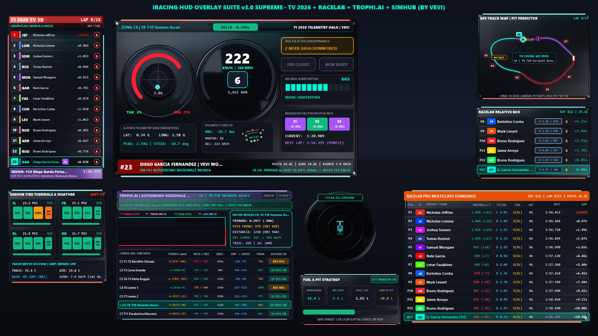
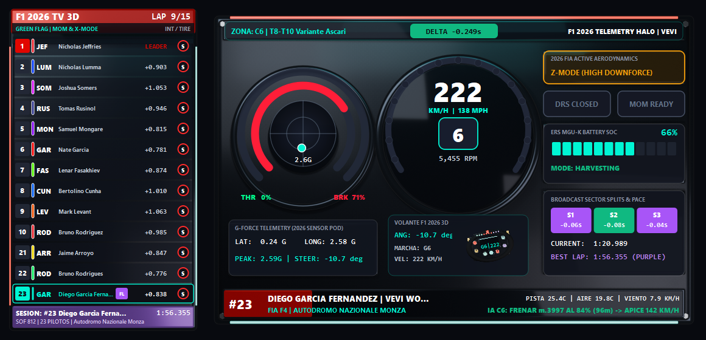
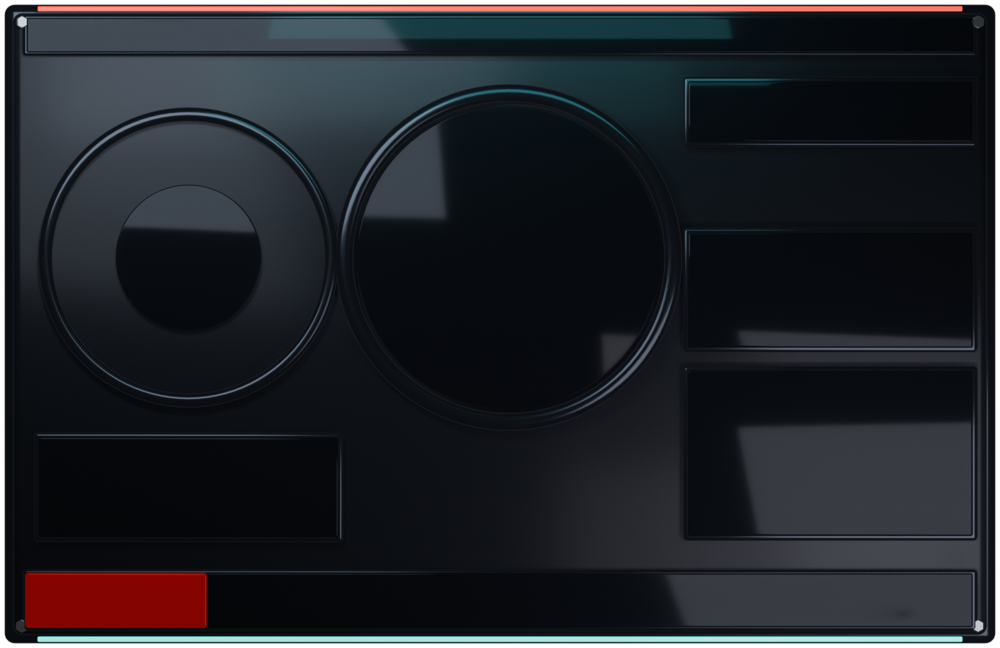
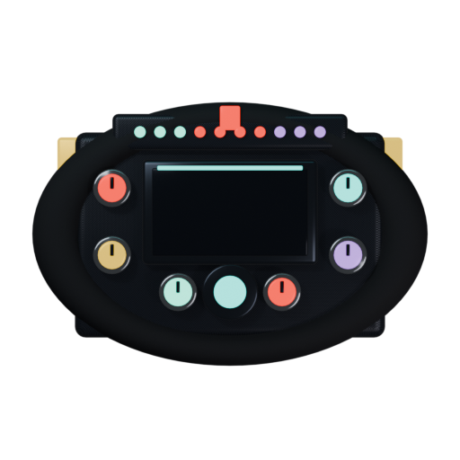
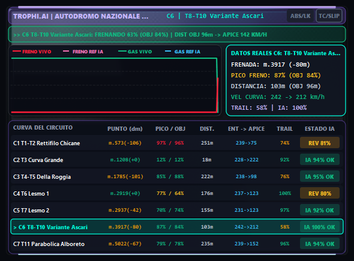
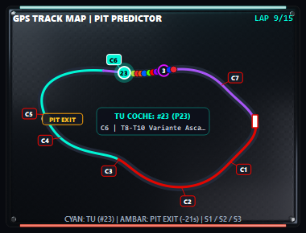
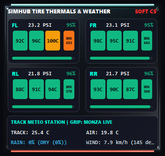
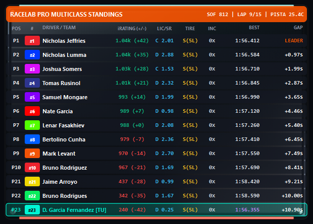
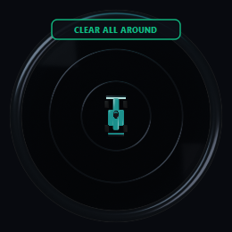
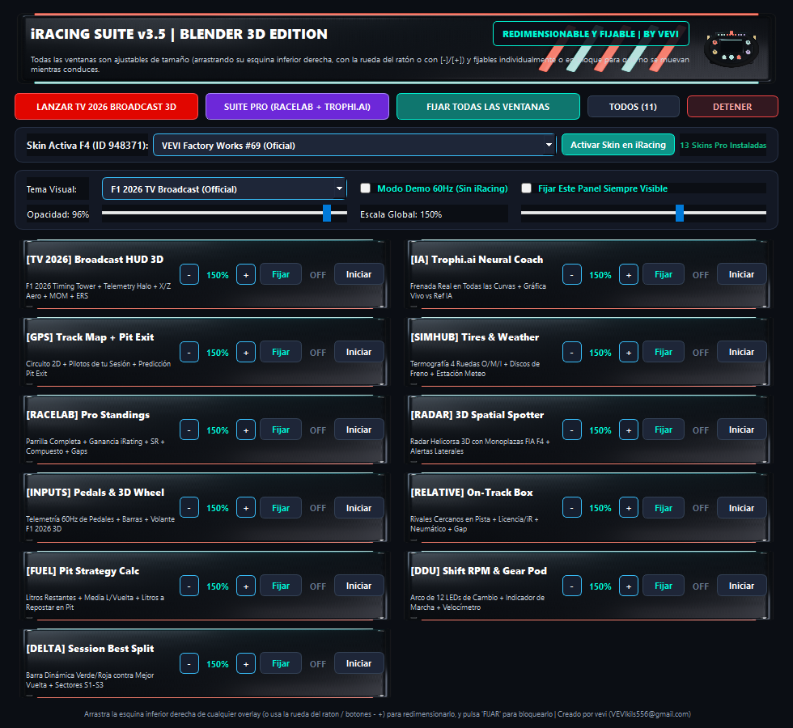

# 🏎️ iRacing HUD Overlay Suite v3.5 Supreme · Blender 3D PBR Edition

<p align="center">
  
  
  
  
  
</p>

> **Suite profesional de telemetría en tiempo real (60 Hz) para iRacing** con interfaz **3D PBR pre-renderizada en Blender 4.2 LTS** (fibra de carbono forjada anisotropic, aluminio CNC anodizado, cristal de zafiro y emisores LED neón). Combina en una sola aplicación **100% gratuita, ajustable y fijable** todas las funciones de **F1 TV Broadcast 2026**, **Trophi.ai Neural Coach**, **RaceLab Pro** y **SimHub**.
>
> **Creador y Autor:** **vevi** (`VEVIkils556@gmail.com`)

---

## 📸 Vista General en Pantalla Completa (1080p HUD Suite v3.5)



---

## ✨ Novedades Principales de la Edición v3.5 Supreme (Blender 3D PBR)

1. **🎨 Chasis e Interfaces 3D Renderizadas en Blender 4.2 LTS (`assets_3d/`)**:
   - Cada módulo cuenta con su propio bisel/chasis 3D renderizado con materiales PBR reales (fibra de carbono twill tejida, metal cepillado con tornillería Allen en las esquinas, biseles emisivos cian/magenta/ámbar y cristal ahumado).
   - Incluye el archivo fuente original de Blender (`assets_3d/iRacing_Overlay_3D_UI_Components.blend`) y el script generador (`generate_blender_ui_assets.py`).
2. **🏁 Telemetría Real de los Pilotos de tu Sesión (`iracing_live_engine.py`)**:
   - Lectura directa del bloque `DriverInfo['Drivers']` y vectores `CarIdx*` a **60 Hz** desde la memoria compartida de iRacing (`pyirsdk`).
   - Muestra los **nombres reales, dorsales (`#CarNumber`), iRating, licencia/SR, coche, diferencias en vivo, paradas en box y vueltas** de todos los pilotos de tu sesión actual (ej. Autodromo Nazionale Monza).
   - Incluye caché inteligente (`telemetry_cache/`) para mantener los últimos datos reales de tu sesión cuando estás fuera de pista o configurando tu HUD.
3. **🧠 Trophi.ai Neural Coach con Frenada Real en TODAS las Curvas del Circuito**:
   - Detecta automáticamente el circuito activo en iRacing (Monza 11 curvas, Spa 19 curvas, o segmentación dinámica universal) y registra en vivo tu **punto de frenada (`You` vs `Opt` en metros)**, **pico de presión de freno (`%`)**, **velocidad mínima de ápice (`km/h`)**, **nota de trail-braking (`0-100%`)** y **ganancia/pérdida de tiempo (`Δs`)** en **cada curva del trazado**.
   - Tabla completa en vivo con todas las curvas del circuito resaltando la curva activa y tus puntos de mejora.
4. **📐 Ventanas 100% Ajustables de Tamaño (Resizable) y Fijables (Lock / Click-Through)**:
   - **Redimensionado libre**: Arrastra la esquina inferior derecha (`◢`) de cualquier ventana o usa la **rueda del ratón (`Ctrl + Rueda` o `Rueda`)** para escalar proporcionalmente entre `50%` y `220%` con re-escalado automático de fuentes y gráficos.
   - **Botones `[FIJAR]` / `[BLOQ]` integrados**: Cada overlay tiene en su esquina superior derecha un botón para **fijar su posición y activar el modo Click-Through** (los clics atraviesan el HUD hacia iRacing). Cuando está bloqueado, pasa el ratón por la esquina superior derecha para revelar el botón `[BLOQ]` y desbloquearlo con un clic.
   - **Atajo global `F8`** y botón maestro en el Centro de Control para bloquear/desbloquear los 11 módulos a la vez.
5. **🔤 Tipografía HUD Reorganizada y Sin Solapamientos**:
   - Motor de truncado inteligente con elipsis (`draw_elided_text`) y sanitizador ASCII/Latin-1 limpio (`sanitize_hud_text`) que garantiza cero caracteres extraños y cero textos superpuestos a cualquier escala.

---

## 🧩 Los 11 Módulos Incluidos en la Suite

### 1. 📺 F1 2026 TV Broadcast Dashboard (`tv_2026_overlay.py`)
Réplica exacta del HUD oficial de retransmisión televisiva 2026 con chasis Halo 3D y volante F1 2026 3D renderizados en Blender:
- **Torre TV Izquierda**: Clasificación en vivo con barra de color de escudería, dorsal, código FIA de 3 letras, compuesto de neumático (`S`/`M`/`H`/`I`/`W`), paradas e intervalo.
- **Arco Central Halo 3D**: Velocímetro digital, marcha engranada, arco RPM neón, barras curvas de acelerador (`THR`) y freno (`BRK`), estado **X-MODE / Z-MODE (Active Aero)**, **Manual Override (MGU-K 350 kW Boost)** y batería **ERS (`%`)** con telemetría G-Force 2D.



| Chasis Halo 3D (Blender 4.2) | Volante F1 2026 3D (Blender 4.2) |
| :---: | :---: |
|  |  |

---

### 2. 🧠 Trophi.ai Neural Coach · All-Corners Live Braking Telemetry (`trophiai_overlay.py`)
Entrenador de IA en vivo con análisis curva por curva:
- **Diagnóstico en tiempo real** de la curva actual/próxima (ej. `FRENA 9M MAS TARDE`, `SUBE PICO +6%`, ` FRENADA CLAVADA`).
- **Comparativa de trazos de frenada**: Curva Maestra Experta (cian discontinuo) vs Tu Frenada en Vivo (naranja/magenta sólido) + trazo de acelerador.
- **Tabla completa de todas las curvas del circuito**: Muestra para cada curva (`T1`..`T11`) el nombre oficial, punto de frenada (`Opt/You`), pico de presión (`%`), velocidad mínima de ápice (`km/h`), nota de trail-braking y delta de tiempo (`Δs`).



---

### 3. 🗺️ RaceLab Pro GPS Track Map + Pit Rejoin Predictor (`trackmap_overlay.py`)
- Mapa vectorial GPS del circuito con sectores coloreados (`S1`, `S2`, `S3`), línea de meta y burbujas en vivo de todos los coches en pista.
- **Círculo Magenta "PIT REJOIN"**: Calcula dónde reincorporarás a pista tras una parada en boxes (`22.5s` pérdida estimada) y te avisa si saldrás en **AIRE LIMPIO** o en **TRÁFICO**.



---

### 4. 🛞 SimHub Pro 4-Tire Thermals (O/M/I) + Dynamic Weather Radar (`tires_weather_overlay.py`)
- Mapa térmico de las 4 ruedas (`FL`, `FR`, `RL`, `RR`) dividido en **3 bandas reales (`O | M | I` — Exterior, Medio, Interior)** con temperaturas en `°C`, presión en `PSI` y barra de vida útil (`%`).
- **Balance de Frenos (`BB`)**, temperaturas de pista/aire, viento (`km/h`), humedad/lluvia (`%`) y evolución del agarre de pista (**Track Grip Evolution**).



---

### 5. 🏆 RaceLab Pro Multiclass Standings Tower (`standings_overlay.py`)
- Tabla de clasificación completa con **SOF (Strength of Field)** calculado con los pilotos reales de tu sesión, vuelta actual, líder, dorsal, nombre completo, badge de licencia + Safety Rating (`A 4.99`), iRating + proyección de ganancia/pérdida (`+48`, `-12`), mejor vuelta, última vuelta, gap y paradas en box.



---

### 6. 📡 Helicorsa 3D Proximity Radar, Pedales + G-Meter, Calculadora Pit/Fuel, Relative, Delta & Core HUD
- **Helicorsa Radar 3D (`radar_overlay.py`)**: Radar espacial cenital con conos de amenaza dinámicos (ámbar a `<6.5m`, rojo crítico a `<2.8m` en paralelo) y alerta de spotter (`CLEAR ALL AROUND` / `CAR LEFT` / `CAR RIGHT`).
- **Inputs Telemetry + G-Force (`inputs_overlay.py`)**: Historial oscilógrafo de 140 muestras de acelerador, freno, embrague y ABS, barras verticales graduadas, volante 3D rotatorio en vivo y bola de fuerzas G longitudinales/laterales.
- **Fuel & Pit Calculator (`fuel_overlay.py`)**: Combustible restante (`L`), consumo medio por vuelta (`L/v`), vueltas restantes con el depósito actual, litros exactos a añadir en la parada (`Refuel`) y estado de estrategia (`SAFE` / `PIT REQUERIDO`).
- **Relative Black Box (`relative_overlay.py`)**, **Lap Time Delta Bar (`delta_overlay.py`)** y **F1 Core Telemetry Pod (`overlay1.py`)**.



---

## 🎛️ Centro de Control v3.5 Supreme (`launcher_gui.py`)

Desde el **Centro de Control** puedes:
- Activar o desactivar individualmente cualquiera de los **11 módulos**.
- **Bloquear / Fijar (`🔒`)** o **Desbloquear (`🔓`)** cada ventana o todas a la vez (`F8`).
- Ajustar el **tamaño (`-` / `+` / `1:1`)** de cada ventana en pasos de `10%`.
- Modificar la **opacidad global (`25%` a `100%`)**.
- Restaurar el diseño de fábrica o guardar tu disposición personalizada en `config.json`.



---

## 🚀 Instalación y Ejecución Rápida (1 Clic · Portable)

### Opción A: Ejecución Instantánea en Windows (Recomendado)
1. Descarga o descomprime el archivo `.zip` en cualquier carpeta de tu PC.
2. Haz doble clic en **`INSTALAR_Y_EJECUTAR.bat`** (o en **`EJECUCION_RAPIDA_TV2026.bat`** / **`INICIAR_OVERLAY_SUITE_V3.bat`**).
   - El script detecta automáticamente tu instalación de Python, crea el entorno virtual `.venv` si no existe, instala `PyQt5`, `pyirsdk` y `PyYAML`, y lanza los 11 módulos + el Centro de Control sin abrir consolas molestas.
3. En **iRacing**, asegúrate de ejecutar el simulador en modo **Ventana sin bordes (Borderless Windowed)** para que los overlays transparentes se superpongan sobre el simulador.

### Opción B: Instalación Manual por Terminal
```bash
git clone https://github.com/vevikils/iRacing-Overlay.git
cd iRacing-Overlay
pip install -r requirements.txt
python main.py --autostart
```

---

## ⌨️ Controles de Ventanas en Vivo (Mover, Redimensionar y Fijar)

| Acción | Cómo hacerlo |
| :--- | :--- |
| **Mover una ventana** | Con la ventana en modo **`[FIJAR]`** (desbloqueada), haz clic izquierdo en cualquier zona del overlay y arrástrala. |
| **Cambiar el tamaño (Ratón)** | Arrastra el tirador diagonal **`◢`** de la esquina inferior derecha de cualquier ventana. |
| **Cambiar el tamaño (Rueda)** | Gira la **rueda del ratón** (o `Ctrl + Rueda`) encima de una ventana desbloqueada para escalar de `50%` a `220%`. |
| **Restaurar tamaño `100%`** | Haz **doble clic izquierdo** en cualquier zona interior de la ventana desbloqueada. |
| **Fijar / Bloquear ventana** | Pulsa el botón **`[FIJAR]`** en la esquina superior derecha de la ventana. Pasará a modo **`[BLOQ]`** (Click-Through total para conducir sin tocar el HUD por accidente). |
| **Desbloquear ventana fijada** | Pasa el ratón por la esquina superior derecha de la ventana bloqueada y haz clic en **`[BLOQ]`**, o pulsa **`F8`**. |
| **Atajo Global Lock / Unlock** | Pulsa **`F8`** en cualquier momento para bloquear o desbloquear los 11 overlays simultáneamente. |

---

## 📂 Estructura del Proyecto

```text
iRacing-Overlay/
├── INSTALAR_Y_EJECUTAR.bat       # Instalador + Lanzador portable en 1 clic para cualquier PC
├── EJECUCION_RAPIDA_TV2026.bat   # Lanzador directo en 1 clic sin consola
├── INICIAR_OVERLAY_SUITE_V3.bat  # Lanzador directo de toda la suite v3.5
├── main.py                       # Punto de entrada principal y gestor de los 11 overlays
├── launcher_gui.py               # Centro de Control v3.5 Supreme (PyQt5 + Blender 3D Header)
├── iracing_live_engine.py        # Motor de telemetría 60 Hz + Pilotos reales + IA de frenada por curva
├── overlay_utils.py              # Clase base ResizableLockableOverlay, text eliding y carga PBR 3D
├── tv_2026_overlay.py            # Módulo 1: F1 2026 TV Broadcast Dashboard + Halo 3D
├── trophiai_overlay.py           # Módulo 2: Trophi.ai Neural Coach (Todas las curvas del circuito)
├── trackmap_overlay.py           # Módulo 3: RaceLab Pro GPS Track Map + Pit Rejoin Predictor
├── tires_weather_overlay.py      # Módulo 4: SimHub Pro 4-Tire O/M/I Thermals + Weather Radar
├── standings_overlay.py          # Módulo 5: RaceLab Pro Multiclass Standings + iR Gain/Loss
├── radar_overlay.py              # Módulo 6: Helicorsa 3D Proximity Spatial Radar
├── inputs_overlay.py             # Módulo 7: Oscilógrafo de Pedales + Volante F1 3D + G-Force
├── fuel_overlay.py               # Módulo 8: Calculadora Inteligente de Combustible y Pit
├── relative_overlay.py           # Módulo 9: Relative Black Box en tiempo real
├── delta_overlay.py              # Módulo 10: Barra de Delta de Mejor Vuelta
├── overlay1.py                   # Módulo 11: F1 Core Telemetry Pod (RPM/Speed/Gear)
├── generate_blender_ui_assets.py # Script de Blender 4.2 LTS para renderizar los chasis 3D PBR
├── assets_3d/                    # Chasis 3D PBR (.png) + escena original (.blend)
├── telemetry_cache/              # Caché de sesión en vivo de iRacing (Autodromo Nazionale Monza)
├── docs/screenshots/             # Capturas de pantalla de alta resolución de todos los módulos
├── config.json                   # Configuración persistente de posiciones, escalas y bloqueos
└── requirements.txt              # Dependencias de Python (PyQt5, pyirsdk, PyYAML)
```

---

## 👤 Autor y Créditos

Desarrollado y diseñado en Python + PyQt5 + Blender 4.2 LTS por **vevi**:
- **Autor:** **vevi**
- **Contacto:** `VEVIkils556@gmail.com`
- **GitHub:** [https://github.com/vevikils/iRacing-Overlay](https://github.com/vevikils/iRacing-Overlay)
